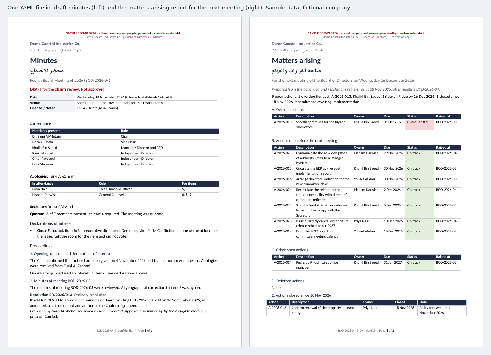
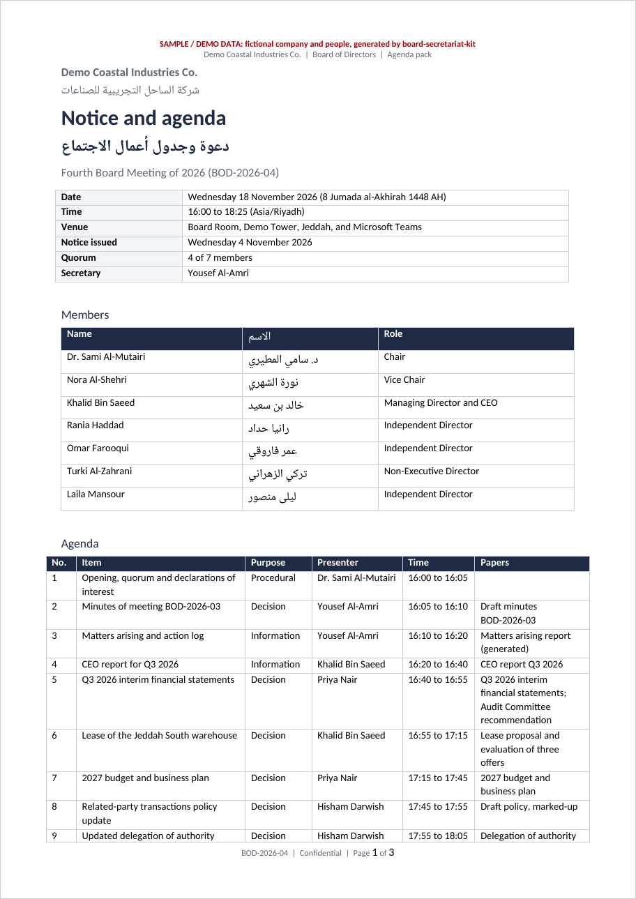
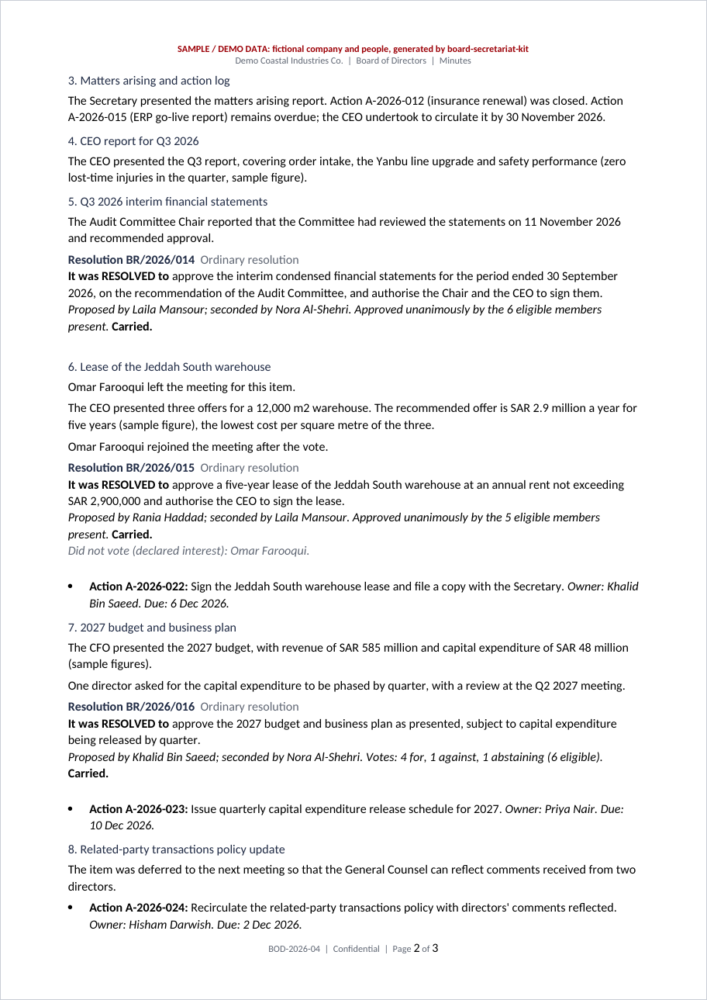
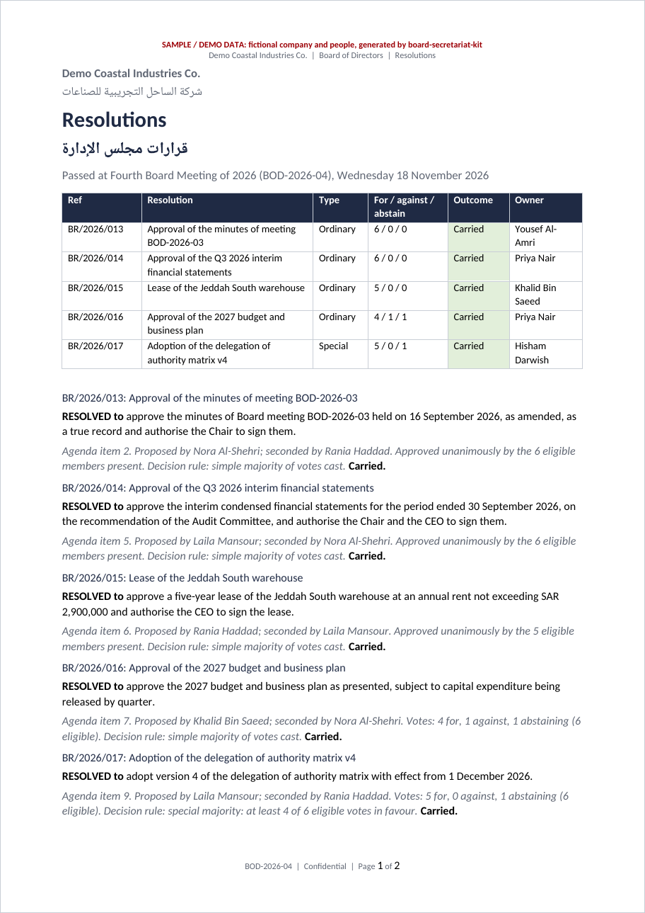
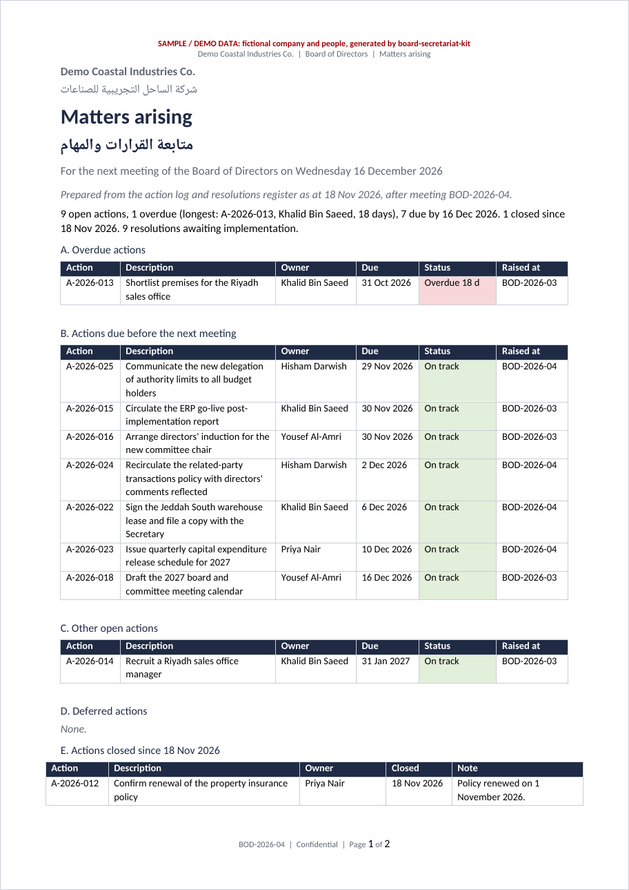
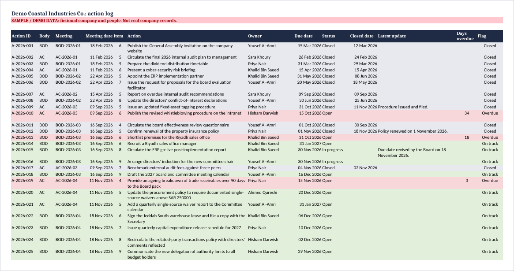
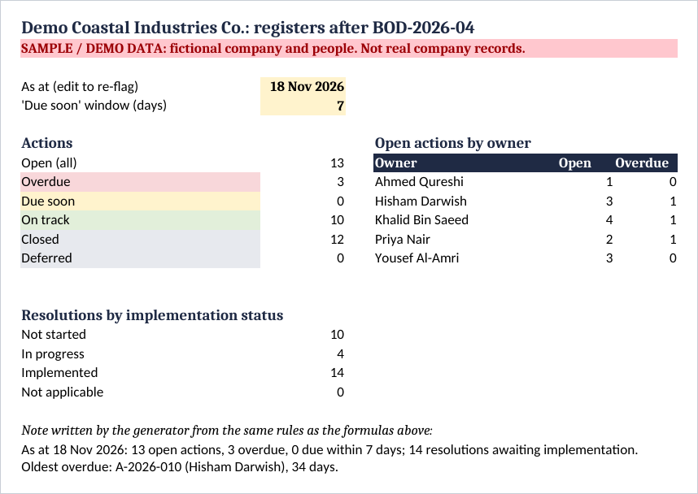

# Board Secretariat Kit


**Business question:** after a board or committee meeting, how does the secretary produce minutes and resolutions
that agree with each other, and know which board decisions and actions are overdue, without retyping the same facts
into five documents?

**What it does:** the secretary keeps one YAML file per meeting (agenda, attendance, notes, resolutions, actions). The
kit turns it into the **agenda pack**, **draft minutes**, **numbered resolutions**, an **updated resolutions register
and action log** in Excel with overdue flags, and the **matters-arising report** for the next meeting. Outputs are
Word, Excel and PDF, with English text and Arabic headings and names.

> **All data in this repository is SAMPLE / DEMO DATA.** "Demo Coastal Industries Co.", its directors and every
> meeting, resolution and action are fictional. Nothing here comes from a real company or from any employer's board
> work. See [`sample_data/README.md`](sample_data/README.md).



Sample outputs: [agenda pack](examples/BOD-2026-04_agenda_pack.pdf) ·
[draft minutes](examples/BOD-2026-04_minutes_DRAFT.pdf) · [resolutions](examples/BOD-2026-04_resolutions.pdf) ·
[matters arising](examples/BOD-2026-04_matters_arising.pdf) · [registers (Excel)](examples/BOD-2026-04_registers.xlsx) ·
[committee minutes](examples/AC-2026-04_minutes_DRAFT.pdf)

## Contents

- [The problem](#the-problem)
- [What it does](#what-it-does)
- [Quick start](#quick-start)
- [Commands](#commands)
- [Screenshots](#screenshots)
- [How it works](#how-it-works)
- [Input format](#input-format)
- [Bilingual output](#bilingual-output)
- [Project layout](#project-layout)
- [Testing](#testing)
- [Prior art studied](#prior-art-studied)
- [Limitations](#limitations)

## The problem

| Task | The manual way | What goes wrong |
|---|---|---|
| Agenda pack | Copy last meeting's Word file, retype times and names | Timings don't add up, old presenters stay in, the matters-arising paper is out of date |
| Minutes | Type from notes, then copy decisions into a separate resolutions document | Wording differs between minutes and resolutions; vote counts don't match who was present |
| Resolution numbers | Look up the last number in a register by hand | Gaps and duplicates, especially across Board and committees |
| Conflicts of interest | Remember who declared what | A conflicted director is counted in a vote |
| Action follow-up | A spreadsheet updated when someone remembers | Overdue actions surface only when the Chair asks |

## What it does

**Before the meeting** (`agenda`)
- Notice and timed agenda (start and end time for each item, purpose, presenter, papers) with the quorum required
- Member list in English and Arabic
- Paper "Matters arising": the body's open, overdue and recently closed actions, and resolutions not yet implemented, as at the notice date
- Gregorian and Umm al-Qura (Hijri) date

**After the meeting** (`pack`)
- **Draft minutes**: attendance, apologies, people in attendance for specific items, quorum statement, declarations of interest, item-by-item notes, resolutions and actions in place, a summary table of actions and signature blocks
- **Resolutions extract**: every resolution with its number, proposer, seconder, vote count, the rule applied and the outcome, plus a certification block
- **Numbering**: resolutions continue each body's series (`BR/2026/013`, `ACR/2026/009`) and restart each year; actions get `A-2026-NNN`
- **Voting rules**: conflicted directors are removed from the vote; ordinary resolutions need more votes for than against; special resolutions need a set share of eligible members (2/3 in the sample); optional chair's casting vote; more votes than eligible members is an error
- **Quorum**: worked out from the body's rules; resolutions cannot be recorded at an inquorate meeting
- **Due dates** that fall on the weekend (Friday and Saturday by default) move to the next working day, and the minutes say so
- **Registers**: updated `resolutions_register.csv` and `action_log.csv`, and an Excel workbook with live formulas
  (days overdue, RAG flag, counts by status and owner), drop-down lists, frozen headers, filters and A4 print setup.
  Change the "as at" date or a status in Excel and the flags recalculate
- **Matters-arising report** for the next meeting: overdue, due before the next meeting, other open, deferred, closed since the meeting, resolutions awaiting implementation and deferred agenda items

**Templates**: the four Word templates in [`templates/`](templates/) can be restyled in Word (logo, fonts, colours,
wording). Keep the `{{ tags }}` and the kit uses your version.

## Quick start

```bash
git clone https://github.com/amirator/board-secretariat-kit.git
cd board-secretariat-kit
python -m venv .venv && source .venv/bin/activate      # Windows: .venv\Scripts\activate
pip install -r requirements-dev.txt
python -m secretariat demo
```

The demo runs the Audit Committee meeting and then the Board meeting, passing the registers from one to the next:

```text
AC-2026-04  (Audit Committee, 11 Nov 2026)
  resolutions ACR/2026/009, ACR/2026/010, ACR/2026/011
  actions     A-2026-019, A-2026-020, A-2026-021
  registers   as at 11 Nov 2026: 10 open, 4 overdue, 1 due soon

BOD-2026-04  (Board of Directors, 18 Nov 2026)
  resolutions BR/2026/013, BR/2026/014, BR/2026/015, BR/2026/016, BR/2026/017
  actions     A-2026-022, A-2026-023, A-2026-024, A-2026-025
  registers   as at 18 Nov 2026: 13 open, 3 overdue, 0 due soon
  note: A-2026-022: due date Fri 04 Dec 2026 falls on the weekend, moved to Sun 06 Dec 2026
  note: A-2026-025: due date Sat 28 Nov 2026 falls on the weekend, moved to Sun 29 Nov 2026
```

Files go to `outputs/demo/<meeting>/`. PDFs are written when LibreOffice is installed; Word and Excel files are
written either way. No Microsoft Office is needed to generate anything.

## Commands

| Command | When | Output |
|---|---|---|
| `python -m secretariat validate MEETING.yaml` | Any time | Lists every problem in the file, or a one-line summary |
| `python -m secretariat agenda MEETING.yaml` | Before the meeting | `*_agenda_pack.docx` (and `.pdf` with `--pdf`) |
| `python -m secretariat pack MEETING.yaml` | After the meeting | Agenda pack, `*_minutes_DRAFT.docx`, `*_resolutions.docx`, `*_matters_arising.docx`, `*_registers.xlsx`, `registers/*.csv` |
| `python -m secretariat demo` | Try it | Both sample meetings, chained |
| `python -m secretariat build-templates` | After changing fonts in `company.yaml` | Rebuilds `templates/*.docx` (overwrites your edits) |

Options for `agenda` and `pack`: `--company`, `--registers` (folder with the two CSVs), `--out`, `--templates`,
`--pdf`, and for `pack`, `--as-of YYYY-MM-DD` (date used for overdue flags; default is the meeting date). The input
registers are never changed; the updated versions are written to `--out`/registers, ready to be the input for the
next meeting. With `make`: `make demo`, `make test`, `make screenshots`, `make help`.

## Screenshots

All images are rendered by `scripts/make_screenshots.py` from the sample outputs.

| Agenda pack | Minutes (page 2) |
|---|---|
|  |  |

| Resolutions | Matters arising |
|---|---|
|  |  |

**Action log** (Excel, flags are formulas driven by the "as at" date on the Summary sheet):



**Register summary** (counts are `COUNTIF`/`COUNTIFS` formulas; the note is written by Python from the same rules):



## How it works

```text
company.yaml ─┐
meeting.yaml ─┼─> model.py      load and check, quorum, eligible voters, vote tally, numbering, weekend roll
registers/ ───┘   registers.py  apply the meeting to the CSV registers, flag overdue, write CSV + Excel
                  arising.py    group open, overdue and closed items for the next meeting
                  render.py     fill templates/*.docx with docxtpl, convert to PDF with LibreOffice
```

- The flag rules exist twice on purpose: once in Python (`registers.action_flag`) for the reports, once as Excel
  formulas so the workbook stays live. A test recalculates the workbook in LibreOffice and checks every flag matches.
- Each run writes new register files and leaves the inputs alone, and it refuses to apply the same meeting twice.

## Input format

A meeting file has four parts. The secretary writes `meeting`, `agenda` and `attendance` before the meeting and adds
`record` afterwards. Full examples: [`sample_data/meetings/`](sample_data/meetings/).

```yaml
meeting:
  id: BOD-2026-04
  body: BOD                       # defined in company.yaml with its members, quorum and resolution prefix
  title: Fourth Board Meeting of 2026
  date: 2026-11-18
  start: "16:00"
  venue: Board Room, Demo Tower, Jeddah, and Microsoft Teams
  notice_date: 2026-11-04
  next_meeting: 2026-12-16
agenda:
  - {item: 6, title: Lease of the Jeddah South warehouse, purpose: Decision, presenter: KBS, minutes: 20, papers: [Lease proposal]}
attendance:
  present: [SMU, NSH, KBS, RHD, OFR, LMN]
  apologies: [TZH]
  in_attendance: [{person: HDR, items: "6, 8, 9"}]
conflicts:
  - {person: OFR, item: 6, nature: Director of one of the bidders. Left the room and did not vote.}
record:
  opened: "16:04"
  closed: "18:12"
  items: {6: {notes: [The CEO presented three offers ...]}}
  resolutions:
    - {item: 6, title: Lease of the Jeddah South warehouse, text: approve a five-year lease ..., proposer: RHD, seconder: LMN, votes: unanimous, owner: KBS}
    - {item: 9, title: ..., text: ..., type: special, votes: {for: 5, against: 0, abstain: 1}, owner: HDR}
  actions:
    - {item: 6, action: Sign the lease and file a copy with the Secretary, owner: KBS, due: 2026-12-04}
  action_updates:
    - {id: A-2026-012, status: Closed, note: Policy renewed on 1 November 2026.}
  deferred: [8]
```

Resolution `text` starts with a verb ("approve ...") so it reads "It was RESOLVED to approve ...". Put quotes around
any text that contains a comma inside `{ }` (the validator catches this). Register columns are listed in
[`secretariat/registers.py`](secretariat/registers.py); `validate` reports unknown people, missing agenda items,
dates in the wrong format, votes that exceed eligible members and more, all in one pass.

## Bilingual output

Documents are written in English with the company name, body name, document titles and members' names also in Arabic,
set right-to-left in an Arabic font (Noto Naskh Arabic by default; any installed font can be set in `company.yaml`).
Full Arabic minutes are not generated: the notes and resolution text are whatever language you type in the YAML.

## Project layout

```text
secretariat/        model.py, registers.py, arising.py, render.py, templates.py, pipeline.py, cli.py
templates/          four editable Word templates (built by templates.py)
sample_data/        fictional company, two meetings, starting registers (see its README)
examples/           sample outputs: PDF, DOCX and XLSX for the Board meeting, committee minutes
docs/               README images
scripts/            make_screenshots.py
tests/              pytest suite
```

## Testing

```bash
python -m pytest -q
```

44 tests cover quorum, vote tallies (unanimous, split, special majority, casting vote, too many votes), numbering
across bodies and years, the weekend roll, input validation, register updates, overdue flags at their boundaries,
CSV round trips, workbook structure (formulas, named ranges, drop-downs, frozen panes) and full demo runs that check
no template tag is left unrendered. Two of the tests need LibreOffice (they produce the PDFs and recalculate the Excel
formulas to compare them with Python) and are skipped without it. GitHub Actions runs the suite on Ubuntu and Windows (Python 3.12 and 3.13)
and in a separate job with LibreOffice installed.

## Prior art studied

Before building I read how others structure this kind of work, and borrowed structure, not code:

- [django/dsf-minutes](https://github.com/django/dsf-minutes): the Django Software Foundation's board minutes, one dated file per meeting from a template with attendance, apologies, ongoing and new business, and action items with named owners. The section order of the minutes follows it.
- [quicwg/wg-materials](https://github.com/quicwg/wg-materials): one folder per meeting holding agenda, minutes and papers. Outputs here are grouped the same way.
- [elapouya/python-docx-template](https://github.com/elapouya/python-docx-template) (docxtpl, used as a library): Word files as Jinja templates, with table-row loops and cell shading; its tests are organised one feature per file.
- [biglocalnews/civic-scraper](https://github.com/biglocalnews/civic-scraper): a clear CLI, Makefile and documentation for agenda and minutes documents.

Most of the top GitHub results for "meeting minutes generator" summarise recordings or transcripts with an LLM. This kit does something
different: it takes the facts the secretary has already recorded and keeps the documents and registers consistent.

## Limitations

- Quorum and majority rules are settings. They are not legal advice and are not checked against any law; take them from your articles of association and committee charters.
- The kit drafts minutes; it does not take notes. The secretary writes the item notes in the YAML.
- PDF export needs LibreOffice. Without it you get DOCX and XLSX only.
- Overdue flags are only as current as the action log. Status changes come in through `action_updates` at a meeting or by editing the Excel/CSV.
- Circular resolutions (passed in writing between meetings), electronic signatures and a board-portal upload are not covered.
- Arabic is used for headings and names only.
- Outputs were checked in LibreOffice (PDF export and formula recalculation). They have not yet been opened in Microsoft Word or Excel; the files are standard DOCX/XLSX written by python-docx, docxtpl and openpyxl.

## Author

Mohammad Amir Khan, Executive Assistant / Office Manager, Jeddah · [github.com/amirator](https://github.com/amirator) · [linkedin.com/in/amir-khan-a31363235](https://www.linkedin.com/in/amir-khan-a31363235/)

Portfolio project on fictional data; it does not describe work for any employer or client. MIT licensed.
